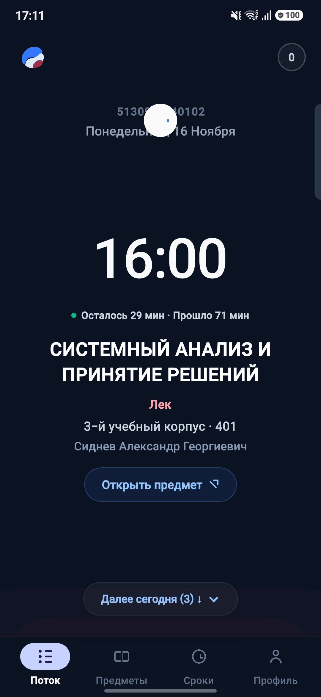
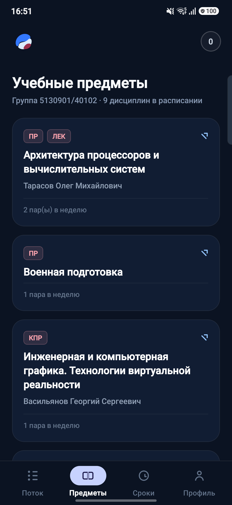
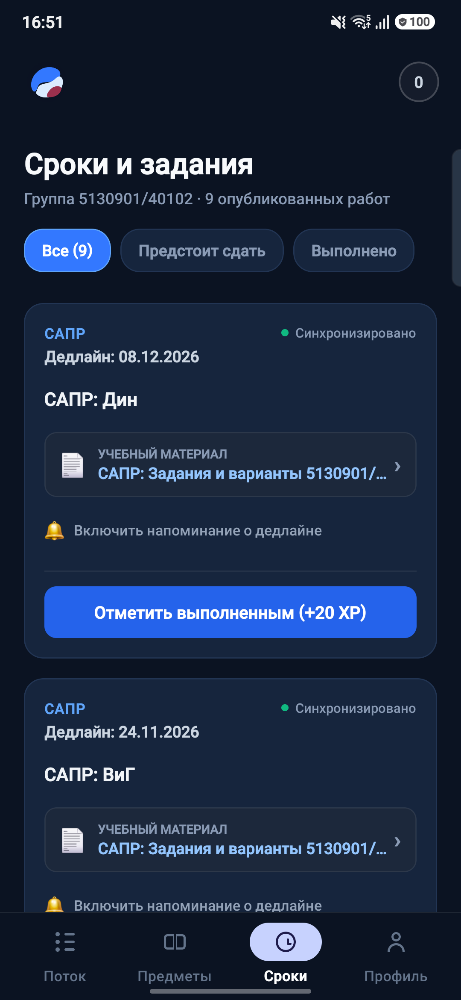

<div align="center">

  

  # Student Value 1.984

  <p><strong>Умный академический компаньон, трекер дедлайнов и мобильное flow-расписание для студентов</strong></p>
  <p>Учёба в своём ритме — без хаоса в чатах, потерянных методичек и пропущенных сроков.</p>

  <p>
    <a href="https://github.com/fuezeevv/student-value/releases/latest">
      
    </a>
    
    
    
    
  </p>

</div>

---

> **Статус Android: техническая предварительная версия.** Опубликованный APK собран как debug-приложение. Мобильные функции проходят отдельную приёмку; локальный тестовый брокер не заменяет проверку Google login на телефоне. Не считайте этот APK готовым публичным клиентом. PDF/DOCX открываются через установленный Android-просмотрщик; этот сценарий ещё требует проверки на устройстве.

## 📸 Интерфейс приложения

<div align="center">
  <table>
    <tr>
      <td align="center" width="33%">
        <strong>Живой Flow-поток</strong><br /><br />
        <br />
        <em>Фокус на текущей паре, прогресс-бар и мягкий амбиент</em>
      </td>
      <td align="center" width="33%">
        <strong>Учебные предметы</strong><br /><br />
        <br />
        <em>Все дисциплины семестра, преподаватели и аудитории</em>
      </td>
      <td align="center" width="33%">
        <strong>Сроки и задания</strong><br /><br />
        <br />
        <em>Умная фильтрация, методички и отметка готовности (+20 XP)</em>
      </td>
    </tr>
  </table>
</div>

---

## 💡 О проекте

Студенческая жизнь полна информационного шума: расписание меняется на портале, методички тонут в архивах десятков чатов, дедлайны фиксируются на разрозненных листочках или в таблицах, а личный статус готовности работ теряется.

**Student Value 1.984** создавался как чистый, молниеносный и эстетичный академический компаньон, решающий эти боли:
- **Мгновенный ответ на вопрос «Что у меня сейчас?»**: больше не нужно искать пару в громоздких таблицах — приложение открывается сразу на текущем или ближайшем занятии.
- **Оригинальные учебные материалы под рукой**: методички (PDF, DOCX) привязаны прямо к соответствующим работам и доступны для скачивания и просмотра офлайн.
- **Спокойный фокус вместо тревожности**: прогресс пары отображается элегантной заполняющейся полосой без навязчивых процентов, а раздел «Сегодня в своём темпе» помогает двигаться по учёбе небольшими комфортными шагами.

---

## ✨ Ключевые возможности

### ⚡ 1. Flow-расписание (Live Schedule Flow)
- **Фокус на текущем моменте**: при открытии сразу видна текущая пара, преподаватель, аудитория и статус.
- **Заполняющийся прогресс-бар**: наглядная полоса времени прямо под крупными часами пары с точным расчётом оставшихся минут.
- **Адаптивный свайп**: потягивание снизу вверх плавно открывает следующий блок занятий на сегодня и актуальные задания.
- **Атмосферный визуал**: мягкий бордовый амбиент-блик у нижней панели навигации, создающий ощущение премиального стеклянного экрана.

### 📚 2. Учебные предметы и материалы
- Предметы из загруженного расписания и опубликованных работ; полный учебный план не подменяется расписанием одной недели.
- Доступ к оригинальным методическим пособиям и заданиям преподавателей.
- Локальное сохранение файлов в память устройства для чтения без интернета.

### ⏱️ 3. Сроки и трекер выполнения
- Умная фильтрация: **Все**, **Предстоит сдать**, **Выполнено**.
- Локальные системные напоминания о приближающихся дедлайнах.
- Модель самостоятельной отметки готовности работы студентом с начислением очков опыта (+20 XP).

### 🧘 4. Сегодня в своём темпе (Focus & Wellbeing)
- Встроенный таймер концентрации для комфортной подготовки к лабораторным и расчётным заданиям.
- Дневной чек-лист микро-шагов по учёбе.
- Индикатор прогресса дня в верхнем правом бейдже.

### 🛡️ 5. Архитектура Offline-First
- Локальная база **SQLite** хранит ранее загруженные расписания, задания и выбранные материалы.
- Сохранённые расписания читаются с устройства без ожидания сети; частота кадров требует измерения на устройстве.
- Очередь отправки (Outbox) с `operationId`, версиями и повторными попытками при активном приложении или возврате в него. Постоянный фоновый сервис не заявляется.

---

## 🛠️ Стек технологий

| Область | Технологии |
| :--- | :--- |
| **Mobile App** | React Native 0.88, Expo 58, TypeScript, Expo SQLite, Expo Notifications, Expo FileSystem |
| **Web & API** | Next.js 15 (App Router), React 19, Tailwind CSS |
| **Backend & База** | PostgreSQL 16, Prisma ORM, строгое соблюдение часового пояса `Europe/Moscow` |
| **Инфраструктура** | Android Debug/Release APK, GitHub Actions, Vercel |

---

## 🚀 Быстрый старт

### Для пользователей (Android)
1. Перейдите в раздел **[Releases](https://github.com/fuezeevv/student-value/releases/latest)**.
2. Скачайте файл `StudentValue-1.984.apk`.
3. Это предварительная debug-сборка; перед повседневным использованием нужна проверка на вашем устройстве.

---

### Для разработчиков (Локальный запуск)

1. **Клонируйте репозиторий:**
   ```bash
   git clone https://github.com/fuezeevv/student-value.git
   cd student-value
   ```

2. **Установите зависимости:**
   ```bash
   npm ci
   ```

3. **Настройте базу данных:**
   Создайте `.env` на основе примера и примените миграции:
   ```bash
   npx prisma migrate deploy
   ```

4. **Запустите проект:**
   ```bash
   # Веб-приложение и API
   npm run dev

   # Мобильное приложение (в отдельном терминале)
   cd apps/mobile && npm run android
   ```

---

## 📦 Релизы и версионирование

Готовые сборки мобильного приложения публикуются на странице **[Releases](https://github.com/fuezeevv/student-value/releases)**. Каждая версия сопровождается списком изменений и прямым APK-файлом.

---

## 📝 Лицензия

Отдельный файл лицензии всего проекта в корне репозитория пока не добавлен. Лицензии сторонних компонентов сохраняются в соответствующих пакетах и ресурсах.

---

<div align="center">
  <sub>Разработано для спокойной и продуктивной учёбы. Student Value 1.984</sub>
</div>

### Нативная версия в работе

В ветке `codex/mobile-safety-review-2026-11-17` добавлены горизонтальное
перелистывание дней, системная/светлая/тёмная тема, редактор существующих работ
и сроков для старосты и лента настоящих публичных постов Telegram. Интеграция
ВКонтакте требует отдельного подключения API; выдуманные публикации не используются.

Офлайн-планы охватывают **только главное здание**: поиск аудиторий, три этажа,
маршрут по исходному графу. Источник — [PolyNavi](https://github.com/AleksandrStarovoitov/PolyNavi).
Планы Aleksandr Starovoitov распространяются по **CC BY-NC-SA 4.0** отдельно
от кода приложения; граф — MIT (Aleksandr Starovoitov, Kirill Bolshakov).
[Лицензии и точная версия источника](apps/mobile/assets/indoor/NOTICE.md).
Планы остальных корпусов и актуальность проходов пока не подтверждены.
Опубликованный ранее APK не следует считать сборкой со всеми этими изменениями.
