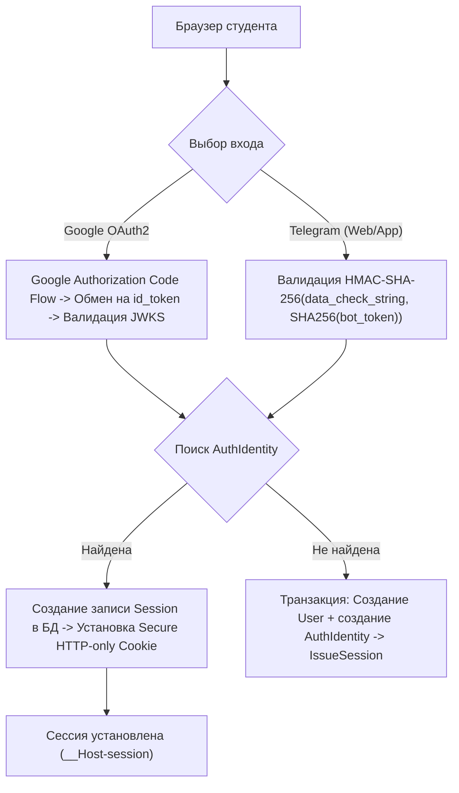

# Архитектурный дизайн системы (ARCHITECTURE)
# Платформа учебного процесса СПбПУ 5130901/40102

---

## 1. Обзор архитектурных принципов

1. **Server-Driven Security:** Ни одно клиентское состояние не считается доверенным. Все проверки прав, валидация входных данных (Zod) и бизнес-правила исполняются строго на стороне сервера.
2. **Decoupled Identity & Privacy by Design:** Физический пользователь (`User`) отделен от учетных записей внешних провайдеров (`AuthIdentity`) и университетской ведомости (`Enrollment`). Публично отображаются только никнеймы; реальные ФИО изолированы.
3. **Multi-Tenant / Multi-Group Ready:** Сущности `CourseDefinition` (дисциплина вообще) и `CourseOffering` (проведение курса в семестре для группы) строго разделены. Список дисциплин никогда не хардкодится в коде и всегда запрашивается динамически из активных `CourseOffering`.
4. **First-Class Provenance & Future AI Readiness:** Достоверность фактов моделируется через сущности `Source` и `SourceReference` с сохранением точных цитат и смещений.
5. **Decoupled Deadlines & Integrations:** Дедлайн (`Deadline`) и события календаря (`ExternalCalendarEvent`) вынесены в самостоятельные сущности. Интеграции изолированы через паттерн Outbox.
6. **Separation of Concerns in Logging:** Доменный `AuditLog` фиксирует только значимые изменения бизнес-данных и ролей; события безопасности (403, 401) направляются в отдельный `SecurityAccessLog`.

---

## 2. Выбор технологического стека

| Уровень стека | Технология | Обоснование |
|---|---|---|
| **Fullstack Framework** | **Next.js 15+ (App Router, Server Actions, RSC)** | Мгновенный серверный рендеринг дашборда без лишнего клиентского JS, типобезопасные мутации через Server Actions, изоляция секретов. |
| **Язык разработки** | **TypeScript 5.x (Strict mode)** | Сквозная типобезопасность от схемы базы данных до UI-компонентов. |
| **База данных** | **PostgreSQL 16+** | Проверенная реляционная целостность, транзакции ACID, JSONB для динамических вариантов и условий допуска, полнотекстовый поиск. |
| **ORM / Data Layer** | **Prisma ORM** | Декларативная схема (`schema.prisma`), строгая типизация запросов, надежные миграции. |
| **Аутентификация** | **Dedicated Multi-Identity Session Engine** | Серверные сессии в БД (`Session`) + безопасные HTTP-only cookies + Google OAuth2 + Telegram HMAC-SHA-256 (Widget и WebApp). |
| **Валидация** | **Zod** | Парсинг и валидация всех входящих DTO на сервере. |
| **UI & Стилизация** | **Tailwind CSS + Radix UI Primitives** | Высококонтрастная инженерная дизайн-система, поддержка Dark/Light тем, доступность по стандарту WAI-ARIA. |
| **Работа с датами** | **date-fns + date-fns-tz** | Надежная поддержка таймзоны `Europe/Moscow`. |
| **Тестирование** | **Vitest + Playwright** | Быстрые unit-тесты логики дедлайнов и прав, интеграционные E2E тесты. |

---

## 3. Архитектура аутентификации и сессий (ADR-009)



### 3.1. Инварианты безопасности аутентификации
1. **Один студент = один User:** Студент может входить как через Google, так и через Telegram. Связи хранятся в `AuthIdentity`.
2. **Запрет автоматического слияния:** Автоматическое объединение аккаунтов по совпадению имени или email **категорически запрещено**.
3. **Связывание аккаунтов (Account Linking):** Привязка дополнительного провайдера допускается **только** из активной, уже авторизованной сессии пользователя.
4. **Валидация Telegram в 2026 году:**
   - **Telegram Login Widget:** проверка хэша данных через `HMAC-SHA-256(data_check_string, SHA256(bot_token))` и верификация `auth_date` ($\le 24$ часов).
   - **Telegram WebApp / Mini App:** проверка `initData` через ключ `HMAC-SHA-256("WebAppData", bot_token)`.

---

## 4. Архитектура приватности: Enrollment vs GroupMember (ADR-010)

```
┌────────────────────────────────────────────────────────┐
│                   StudyGroup (40102)                   │
├──────────────────────────┬─────────────────────────────┤
│  Enrollment (Ведомость)  │   GroupMember (Приложение)  │
│  - fullName (Реальное)   │   - userId (FK -> User)     │
│  - subgroup (1 или 2)    │   - isOwner (Староста)      │
│  - studentIdNumber       │   - Роли и права (RBAC)     │
│  - status (PENDING/...)  │                             │
│  - userId (FK -> User)   │                             │
└───────────────▲──────────┴──────────────▲──────────────┘
                │                         │
                └───────────┬─────────────┘
                            │ Инвариант: строго 1:1 связь
                     ┌──────┴──────┐
                     │    User     │
                     │  - nickname │ (Публичный профиль)
                     │  - avatarUrl│
                     └─────────────┘
```

- **Разделение источников:**
  - `Enrollment` является единственным источником академической ведомости группы.
  - `User` является профилем пользователя в приложении.
- **Инвариант 1:1:**
  - Ограничение `UNIQUE(groupId, userId)` в `Enrollment` гарантирует, что один пользователь не может быть привязан к двум студентам в одной группе.
- **Изоляция ПДн:**
  - В интерфейсе отображаются только `nickname` и `avatarUrl`.
  - Поле `fullName` доступно строго администраторам с правом `view_private_member_identity`.

---

## 5. Гранулярная ролевая модель (Telegram-like Permission RBAC)

### 5.1. Реестр атомарных прав
- `manage_group` — базовые настройки группы;
- `manage_members` — управление участниками;
- `view_private_member_identity` — просмотр реальных ФИО студентов;
- `manage_courses` — создание и редактирование курсов;
- `manage_tasks` — публикация и редактирование заданий;
- `manage_deadlines` — назначение и перенос сроков сдачи;
- `manage_materials` — добавление учебных материалов;
- `manage_announcements` — публикация оперативных объявлений;
- `verify_progress` — официальное подтверждение сдачи работ преподавателем (`ACCEPTED`);
- `manage_course:<courseOfferingId>` — право управления конкретным курсом (Course Manager).

### 5.2. Реализация проверок прав
Все мутации выполняются через функции безопасности:
```typescript
// Проверка права старосты/администратора
await requirePermission(session.userId, groupId, "manage_tasks");

// Проверка права верификации сдачи
await requirePermission(session.userId, groupId, "verify_progress");
```

---

## 6. Жизненный цикл задания и дедлайнов

### 6.1. Разделение статусов задачи и прогресса студента (ADR-015)
- **`Task.status`** (состояние публикации):
  `DRAFT` (черновик) $\to$ `PUBLISHED` (опубликовано) $\to$ `ARCHIVED` / `CANCELLED`.
- **`StudentTaskProgress.status`** (прогресс студента):
  `NOT_STARTED` $\to$ `IN_PROGRESS` $\to$ `READY` $\to$ `SUBMITTED` $\to$ `ACCEPTED` / `NEEDS_FIX`.

### 6.2. Trust Model для статуса `ACCEPTED`
- Студент может самостоятельно переводить задачу в статус `SUBMITTED` («Отчет сдан на проверку»).
- Статус `ACCEPTED` с флагом `isVerified = true` устанавливается **только** пользователями с правом `verify_progress` (староста/преподаватель) либо через официальный импорт ведомости.

### 6.3. Независимая сущность Deadline (ADR-011)
- Задание может иметь несколько дедлайнов (например, `SOFT` — рекомендуемый срок для самоконтроля, `HARD` — окончательный срок приема).
- При переносе дедлайна создается новая запись `Deadline`, ссылающаяся на `originalDeadlineId`, что сохраняет прозрачную историю изменений.

---

## 7. Модель источников данных (Source & SourceReference) (ADR-012)

Каждая задача, дедлайн, объявление и факт преподавания связывается с первоисточником:
- `Source` хранит реквизиты документа, аудиозаписи или протокола занятия.
- `SourceReference` хранит точную цитату (`quoteText`), уровень уверенности (`CONFIRMED`, `INFERRED`, `DISPUTED`) и таймкоды/смещения.
- **Подготовка к AI:** В Фазе 3 AI-ассистент использует `SourceReference` для формирования ответов со строгими ссылками на первоисточники без галлюцинаций.

---

## 8. Моделирование неопределенности преподавателей

В курсе «Статистическая обработка больших данных» (СОВД) зафиксирован конфликт источников: Семенов К.К. vs Кадргулов Р.Р.
- Флаг конфликта снят с сущности `Teacher` (преподаватель как человек не является конфликтом).
- В таблице связи `CourseTeacher` указывается статус:
  - `status: DISPUTED` или `CANDIDATE_UNVERIFIED`;
  - `sourceReferenceId`: ссылка на цитату/источник упоминания;
  - `notes`: текстовое примечание о конфликтующих источниках.
- В UI оба преподавателя отображаются с пометкой «Требует уточнения», система не делает необоснованного выбора.

---

## 9. Изоляция Dev Role Switcher (ADR-016)

1. Переключатель ролей активен **только** при `process.env.NODE_ENV === 'development'`.
2. В production сборке Next.js код dev-компонента полностью исключается, а серверные эндпоинты возвращают `404 Not Found`.
3. Для отладки используются детерминированные seed-пользователи:
   - `dev-owner` (Расул Батукаев, права `OWNER`);
   - `dev-student` (обычный студент без административных прав).
4. Все проверки прав на сервере выполняются реально через БД даже в dev-режиме.

---

## 10. Разделение системных и доменных логов (ADR-013)

- **`AuditLog`:** Доменный аудит изменений бизнес-сущностей (`CREATE_TASK`, `UPDATE_DEADLINE`, `GRANT_ROLE`, `VERIFY_PROGRESS`). Доступен старосте в интерфейсе.
- **`SecurityAccessLog`:** Технический журнал отказов в доступе (403, 401, rate-limit). Хранится отдельно и не засоряет доменный журнал.
