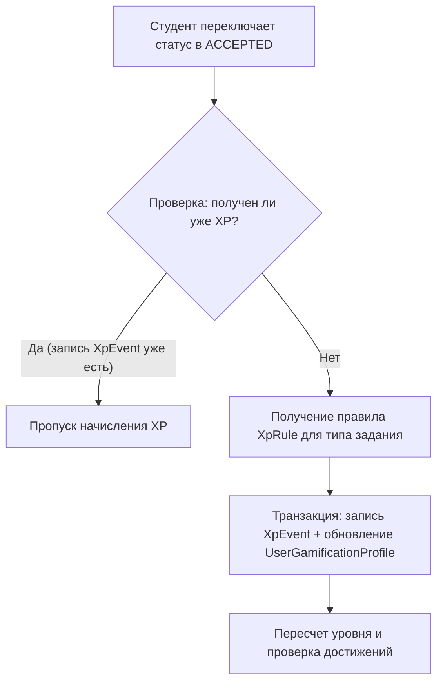

# Архитектурный дизайн системы (ARCHITECTURE)
# Платформа учебного процесса СПбПУ 5130901/40102

---

## 1. Обзор архитектурных принципов

1. **Server-Driven Security:** Ни одно клиентское состояние не считается доверенным. Все проверки прав, валидация входных данных и бизнес-правила исполняются строго на стороне сервера.
2. **Decoupled Identity:** Физический пользователь (`User`) отделен от учетных записей внешних провайдеров (`AuthIdentity`) и университетской ведомости (`Enrollment`).
3. **Multi-Tenant / Multi-Group Ready:** Сущности `CourseDefinition` (дисциплина в принципе) и `CourseOffering` (проведение курса в конкретном семестре для конкретной группы) разделены.
4. **Resilient Integrations:** Интеграции с внешними API (Google Calendar, Telegram, S3) изолированы через механизм Outbox / Background Jobs и никогда не блокируют ключевые CRUD-транзакции.
5. **Deterministic Business Logic:** Расчет дедлайнов, прогресса и XP выполняется детерминированными функциями; AI не привлекается для математических или фактических вычислений.

---

## 2. Выбор технологического стека и обоснование

| Уровень стека | Технология | Обоснование выбора |
|---|---|---|
| **Fullstack Framework** | **Next.js 15+ (App Router, Server Actions, RSC)** | Обеспечивает мгновенный рендеринг на сервере (RSC) без лишнего клиентского JS, типобезопасные Server Actions для мутаций, стриминг данных, встроенную изоляцию секретов. |
| **Язык разработки** | **TypeScript 5.x (Strict mode)** | Единая типобезопасность сквозь базу данных, бизнес-логику и UI-компоненты. Исключает опечатки в идентификаторах и типах заданий. |
| **База данных** | **PostgreSQL 16+** | Проверенная реляционная модель, транзакционность (ACID), поддержка JSONB для гибких метаданных и требований допуска, развитый полнотекстовый поиск. |
| **ORM / Data Layer** | **Prisma ORM** | Декларативная схема (`schema.prisma`), надежный миграционный движок, типобезопасный Query Builder, строгая типизация связей, поддержка PostgreSQL. |
| **Аутентификация** | **Custom Multi-Identity Auth (NextAuth / JWT Session)** | Поддержка независимых провайдеров (Google OAuth2 + Telegram Login Widget HMAC), сессионный токен, исключающий коллизии профилей. |
| **Валидация данных** | **Zod** | Парсинг и валидация всех входящих DTO на сервере с автоматическим выводом TypeScript-типов. |
| **UI & Стилизация** | **Tailwind CSS + Radix UI Primitives** | Легковесная, контролируемая дизайн-система без громоздких сторонних UI-библиотек. Высокая доступность (ARIA), поддержка Dark/Light тем. |
| **Работа с датами** | **date-fns + date-fns-tz** | Надежная поддержка таймзоны `Europe/Moscow`, корректный расчет оставшихся дней и интервалов. |
| **Тестирование** | **Vitest + Playwright** | Быстрый unit/integration тестовый раннер (Vitest) и надежные E2E сценарии критических путей (Playwright). |

---

## 3. Модель уровней приложения (Layered Architecture)

```
┌────────────────────────────────────────────────────────┐
│             Presentation Layer (UI & Routes)           │
│  - React Server Components (RSC) for view data loading │
│  - Client Components only for rich interactivity       │
│  - Server Actions for form submissions & mutations     │
└──────────────────────────┬─────────────────────────────┘
                           │
┌──────────────────────────▼─────────────────────────────┐
│          Domain & Application Services Layer           │
│  - Security Context & Permission Resolver              │
│  - Course & Task Management Service                    │
│  - Student Progress Engine                             │
│  - Deadline Calculation & Sorting Engine               │
│  - Idempotent Gamification (XP) Service                │
└──────────────────────────┬─────────────────────────────┘
                           │
┌──────────────────────────▼─────────────────────────────┐
│             Data Access & Persistence Layer            │
│  - Prisma Client & Repositories                        │
│  - Outbox Pattern for Async External Integrations      │
│  - PostgreSQL Database                                 │
└────────────────────────────────────────────────────────┘
```

---

## 4. Стратегия аутентификации и мульти-идентичности

### 4.1. Разделение сущностей
- `User` — центральный профиль студента:
  - `id` (UUID);
  - `nickname` (публичное имя);
  - `avatarUrl` (аватар);
  - `isActive` (флаг активности);
  - `createdAt`, `updatedAt`.
- `AuthIdentity` — связь с внешним провайдером:
  - `id` (UUID);
  - `userId` (FK $\to$ `User`);
  - `provider` (`GOOGLE` | `TELEGRAM` | `LOCAL_DEV`);
  - `providerUserId` (уникальный ID в системе провайдера);
  - `email` (только для Google, приватное поле);
  - `metadata` (JSONB с техническими атрибутами токена/авторизации);
  - `createdAt`.
- `Enrollment` — университетская идентичность:
  - `id` (UUID);
  - `groupId` (FK $\to$ `StudyGroup`);
  - `userId` (nullable FK $\to$ `User`, заполняется при привязке);
  - `fullName` (реальное ФИО студента);
  - `studentCardNumber` (опциональный номер студенческого);
  - `subgroup` (номер подгруппы при наличии);
  - `status` (`PENDING_CLAIM` | `ACTIVE` | `ARCHIVED`).

### 4.2. Безопасное связывание аккаунтов (Account Linking Flow)
- При первой авторизации через Google или Telegram создается новый `User` и соответствующий `AuthIdentity`.
- Если студент хочет добавить второй метод входа (например, привязать Telegram к уже созданному через Google аккаунту):
  1. Студент должен быть **уже авторизован** в целевом аккаунте.
  2. Переходит в настройки профиля $\to$ «Привязать Telegram».
  3. Проходит валидацию Telegram Widget (с проверкой криптографической подписи HMAC-SHA-256 секретным токеном бота).
  4. Если `providerUserId` Telegram еще не привязан к другому `User`, создается запись `AuthIdentity` для текущего пользователя.
  5. Если `providerUserId` уже занят другим аккаунтом — операция отклоняется с понятной ошибкой и предложением объединения через администратора.
  6. **Строгий запрет:** Автоматическое слияние аккаунтов по совпадению email или имени пользователя категорически исключено.

---

## 5. Стратегия авторизации и RBAC (Permission-Based Access Control)

### 5.1. Принцип полномочий
Авторизация построена по образцу администрирования каналов и чатов Telegram:
- Пользователь имеет базовую роль в группе (например, `OWNER`, `ADMIN`, `MEMBER`, `GUEST`).
- Административные роли обладают динамическим списком гранулярных прав (`Permissions`).
- Расул Батукаев как инициатор группы 40102 обладает статусом `OWNER` и может назначать администраторов, гибко выбирая выдаваемые права.

### 5.2. Реестр базовых прав (Permissions Registry)

| Код права | Описание действия |
|---|---|
| `manage_group` | Изменение настроек группы, интеграций и метаданных |
| `manage_members` | Добавление участников, связывание `Enrollment`, исключение |
| `view_private_member_identity` | Просмотр реальных ФИО и персональных данных студентов |
| `manage_roles` | Назначение ролей и распределение прав другим участникам |
| `manage_courses` | Создание, редактирование и архивирование курсов (`CourseOffering`) |
| `manage_tasks` | Добавление, редактирование и удаление заданий |
| `manage_deadlines` | Изменение дедлайнов и графиков сдачи |
| `manage_materials` | Загрузка и прикрепление учебных материалов и ссылок |
| `manage_announcements` | Публикация и закрепление оперативных объявлений |
| `manage_gamification` | Настройка правил XP, ручная корректировка баланса очков |
| `manage_course:<courseOfferingId>` | Ограниченное право управления конкретным курсом (Course Manager) |

### 5.3. Механизм проверки прав на сервере
Каждый Server Action или API endpoint использует унифицированный Guard:
```typescript
await requirePermission(userSession, groupId, "manage_tasks");
// либо контекстно-зависимая проверка:
await requireCoursePermission(userSession, courseOfferingId, "manage_tasks");
```
Попытка вызова без соответствующего права возвращает типизированную ошибку авторизации `FORBIDDEN (403)` с логированием в `AuditLog`.

---

## 6. Движок дедлайнов и прогресса

### 6.1. Расчет состояний срочности (Deadline State Machine)
Функция расчета дедлайна принимает дату/время задания, текущий момент времени (`currentDate`) и статус выполнения студента:
1. Если статус студента `ACCEPTED` — дедлайн считается успешно закрытым независимо от даты.
2. Если дедлайн `null` — статус `NO_DEADLINE` («Срок не указан»).
3. Если текущее время $> dueAt$: статус `OVERDUE` (Просрочено).
4. Если дата совпадает с текущим днем (в зоне `Europe/Moscow`): `DUE_TODAY`.
5. Если дата совпадает со следующим днем: `DUE_TOMORROW`.
6. Если оставшееся время $\le 7$ дней: `DUE_URGENT`.
7. В остальных случаях: `UPCOMING`.

### 6.2. Идемпотентность начисления XP

Уникальный составной ключ `(userId, taskId, eventType)` в таблице `XpEvent` предотвращает накрутку очков при многократном переключении статусов.

---

## 7. Модель интеграции с Google Calendar

1. **Асинхронный Outbox:**
   При изменении дедлайна задание обновляется в БД, и одновременно в таблицу `CalendarSyncQueue` добавляется запись с операцией (`CREATE` | `UPDATE` | `DELETE`).
2. **Фоновый воркер (Sync Worker):**
   Обрабатывает очередь, вызывая Google Calendar API с использованием сервисного аккаунта или OAuth-токена группы.
3. **Обновление без дублирования:**
   Идентификатор события `externalCalendarEventId` сохраняется в таблице `Task`. При переносе дедлайна событие в Google Calendar модифицируется через метод `PATCH`.
4. **Отказоустойчивость:**
   Ошибка сети или исчерпание квоты Google API не откатывает создание задания; воркер повторяет попытку с экспоненциальной задержкой (Exponential Backoff).

---

## 8. Аудит и безопасность (Audit & Security)

1. **Журналирование чувствительных действий (`AuditLog`):**
   - Кто совершил действие (`userId`);
   - Что было сделано (`action`: `TASK_CREATED`, `DEADLINE_UPDATED`, `ROLE_GRANTED`, etc.);
   - Целевой ресурс (`entityType`, `entityId`);
   - Снимок изменений (`diff` / `metadata` в JSONB);
   - IP-адрес и User-Agent.
2. **Защита от уязвимостей:**
   - Все запросы параметризованы через ORM (защита от SQL-инъекций).
   - Строгая санитизация Markdown/HTML в описаниях заданий и объявлений (защита от XSS).
   - Rate limiting на эндпоинтах авторизации и изменения статусов.
