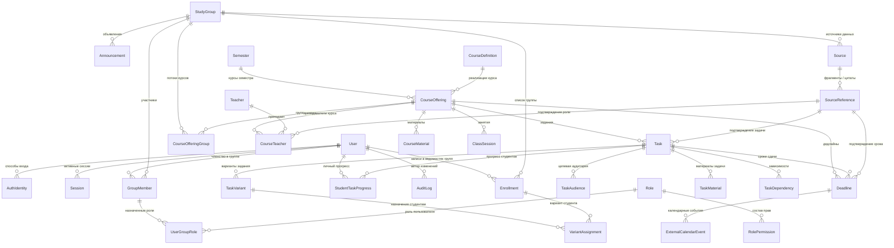

# Модель данных и схема БД (DATA_MODEL)
# Платформа учебного процесса СПбПУ 5130901/40102

---

## 1. Обновленная диаграмма сущностей и связей (ER Diagram)



---

## 2. Перечисления (Enums)

```prisma
enum AuthProvider {
  GOOGLE
  TELEGRAM
  LOCAL_DEV
}

enum EnrollmentStatus {
  PENDING_CLAIM    // Запись в ведомости группы, аккаунт еще не привязан
  CLAIMED          // Привязан студентом, ожидает проверки старостой
  VERIFIED         // Официально подтвержденное соответствие студента
  ARCHIVED         // Отчислен / переведен
}

enum SourceType {
  OFFICIAL_DOCUMENT   // Приказ, методическое пособие, учебный план, ведомость
  TEACHER_STATEMENT   // Сообщение, письмо, слова преподавателя на занятии
  HEADMAN_RECORD      // Запись и фиксация старостой
  CLASS_SESSION       // Протокол учебного занятия
  TRANSCRIPT_SEGMENT  // Фрагмент аудиозаписи / транскрипта
  STUDENT_PERSONAL    // Персональная рабочая заметка студента
}

enum ConfidenceLevel {
  CONFIRMED           // Достоверно подтвержденный факт
  INFERRED            // Выведено эвристически / системой
  DISPUTED            // Спорный / конфликтующий факт
}

enum TeacherCourseStatus {
  CONFIRMED           // Подтвержденный преподаватель курса
  CANDIDATE_UNVERIFIED// Кандидат (требует уточнения)
  DISPUTED            // Конфликт данных (например, СОВД: Семенов vs Кадргулов)
}

enum TaskType {
  LABORATORY          // Лабораторная работа
  HOMEWORK            // Домашнее задание
  EXERCISE            // Упражнение на паре
  CALCULATION_WORK    // Расчетная работа (РР / РГР)
  PRACTICAL           // Практическое задание
  COURSEWORK          // Курсовая работа / проект
  TEST                // Контрольная работа / тест
  EXAM_PREPARATION    // Подготовка к зачету/экзамену
  CREATIVE_WORK       // Творческое задание
  OPTIONAL            // Факультативное задание
  OTHER               // Прочее
}

enum TaskStatus {
  DRAFT               // Черновик (виден только администраторам)
  PUBLISHED           // Опубликовано (доступно студентам)
  ARCHIVED            // Архивировано
  CANCELLED           // Отменено преподавателем
}

enum TaskAudienceType {
  ALL_COURSE          // Все студенты курса
  GROUP               // Конкретная учебная группа (например, только 40102)
  SUBGROUP            // Конкретная подгруппа (подгруппа 1 или 2)
  INDIVIDUAL          // Индивидуальные студенты
}

enum DeadlineType {
  HARD                // Жесткий дедлайн (после него прием закрыт/штраф)
  SOFT                // Рекомендуемый / ориентировочный срок
}

enum DeadlineStatus {
  ACTIVE              // Действующий срок
  POSTPONED           // Перенесен преподавателем
  SUPERSEDED          // Заменен новым дедлайном
  CANCELLED           // Срок отменен
}

enum StudentTaskProgressStatus {
  NOT_STARTED         // Не начато
  IN_PROGRESS         // В работе
  READY               // Готово к сдаче/демонстрации
  SUBMITTED           // Сдано / отчет отправлен (Self-Reported)
  ACCEPTED            // Принято / защищено (Verified)
  NEEDS_FIX           // Возвращено на доработку
}

enum CalendarSyncStatus {
  PENDING
  SYNCED
  FAILED
}
```

---

## 3. Таблицы аутентификации, сессий и пользователей

### 3.1. `User` (Профиль пользователя приложения)
| Поле | Тип | Ограничения | Описание |
|---|---|---|---|
| `id` | UUID | PK, default `gen_random_uuid()` | Уникальный ID пользователя |
| `nickname` | String(50) | Unique, Not Null | Публичный никнейм в приложении |
| `avatarUrl` | String | Nullable | URL аватара |
| `bio` | String(255) | Nullable | Статус / био |
| `isSystemAdmin` | Boolean | Default `false` | Глобальный системный администратор |
| `createdAt` | TimestampTZ | Default `now()` | Дата создания |
| `updatedAt` | TimestampTZ | Auto update | Дата обновления |

### 3.2. `AuthIdentity` (Способы входа пользователя)
| Поле | Тип | Ограничения | Описание |
|---|---|---|---|
| `id` | UUID | PK | Уникальный ID связи |
| `userId` | UUID | FK $\to$ `User.id`, Cascade | Пользователь |
| `provider` | `AuthProvider` | Not Null | `GOOGLE`, `TELEGRAM`, `LOCAL_DEV` |
| `providerUserId` | String | Not Null | Уникальный ID провайдера (Google sub, Telegram id) |
| `email` | String | Nullable | Email (только от Google, приватный) |
| `metadata` | JSONB | Default `{}` | Данные Telegram username, auth_date, хэш |
| `createdAt` | TimestampTZ | Default `now()` | Дата привязки |
*Индекс:* `UNIQUE(provider, providerUserId)`

### 3.3. `Session` (Серверные сессии пользователей)
| Поле | Тип | Ограничения | Описание |
|---|---|---|---|
| `id` | UUID | PK | ID сессии |
| `userId` | UUID | FK $\to$ `User.id`, Cascade | Пользователь сессии |
| `tokenHash` | String | Unique, Not Null | SHA-256 хэш сессионного токена |
| `expiresAt` | TimestampTZ | Not Null | Срок действия куки |
| `ipAddress` | String | Nullable | IP клиента |
| `userAgent` | String | Nullable | Браузер/устройство |
| `createdAt` | TimestampTZ | Default `now()` | Дата входа |

---

## 4. Разделение Enrollment и GroupMember (Приватность и ведомость)

### 4.1. `StudyGroup` (Учебная группа)
- `id` (UUID, PK)
- `code` (String(50), Unique: e.g. `5130901/40102`)
- `name` (String(100))
- `department` (String(100), e.g. `ИКНК`)
- `program` (String(100), e.g. `09.03.01 Информатика и вычислительная техника`)
- `calendarId` (String, Nullable: Google Calendar ID группы)
- `createdAt` (TimestampTZ, default `now()`)

### 4.2. `Enrollment` (Академическая ведомость группы)
| Поле | Тип | Ограничения | Описание |
|---|---|---|---|
| `id` | UUID | PK | Уникальный ID записи ведомости |
| `groupId` | UUID | FK $\to$ `StudyGroup.id`, Cascade | Группа |
| `userId` | UUID | FK $\to$ `User.id`, Nullable | Привязанный профиль студента |
| `fullName` | String(150) | Not Null | Реальное ФИО студента (защищенные ПДн) |
| `subgroup` | Int | Nullable | Номер подгруппы (1 или 2) |
| `studentIdNumber` | String(50) | Nullable | Номер студенческого билета / зачетки |
| `status` | `EnrollmentStatus` | Default `PENDING_CLAIM` | Статус привязки |
| `claimToken` | String | Unique, Nullable | Одноразовый инвайт-токен привязки |
| `verifiedById` | UUID | FK $\to$ `User.id`, Nullable | Кто подтвердил соответствие (староста) |
| `verifiedAt` | TimestampTZ | Nullable | Время подтверждения |
| `createdAt` | TimestampTZ | Default `now()` | Дата создания |
*Инвариант:* `UNIQUE(groupId, fullName)`  
*Инвариант 1:1:* `UNIQUE(groupId, userId)` (для записей, где `userId IS NOT NULL`)

### 4.3. `GroupMember` (Участие User в пространстве приложения)
| Поле | Тип | Ограничения | Описание |
|---|---|---|---|
| `id` | UUID | PK | Уникальный ID членства |
| `groupId` | UUID | FK $\to$ `StudyGroup.id`, Cascade | Группа |
| `userId` | UUID | FK $\to$ `User.id`, Cascade | Пользователь приложения |
| `isOwner` | Boolean | Default `false` | Статус владельца пространства (Расул) |
| `joinedAt` | TimestampTZ | Default `now()` | Дата вступления |
*Индекс:* `UNIQUE(groupId, userId)`

---

## 5. Роли и динамические полномочия (RBAC)

### 5.1. `Role`
- `id` (UUID, PK)
- `groupId` (UUID, FK $\to$ `StudyGroup.id`, Cascade)
- `name` (String: `Admin`, `CourseManager`, `Student`, `Guest`)
- `isDefault` (Boolean, default `false`)

### 5.2. `RolePermission`
- `id` (UUID, PK)
- `roleId` (UUID, FK $\to$ `Role.id`, Cascade)
- `permission` (String, Not Null) — e.g. `manage_tasks`, `manage_deadlines`, `manage_materials`, `manage_announcements`, `verify_progress`, `view_private_member_identity`, `manage_course:<offeringId>`
*Индекс:* `UNIQUE(roleId, permission)`

### 5.3. `UserGroupRole`
- `id` (UUID, PK)
- `groupMemberId` (UUID, FK $\to$ `GroupMember.id`, Cascade)
- `roleId` (UUID, FK $\to$ `Role.id`, Cascade)
*Индекс:* `UNIQUE(groupMemberId, roleId)`

---

## 6. Двухуровневая модель источников (Source & SourceReference)

### 6.1. `Source` (Первоисточник)
| Поле | Тип | Ограничения | Описание |
|---|---|---|---|
| `id` | UUID | PK | Уникальный ID источника |
| `groupId` | UUID | FK $\to$ `StudyGroup.id`, Cascade | Учебная группа |
| `type` | `SourceType` | Not Null | Тип источника |
| `title` | String(255) | Not Null | Название (e.g. «Методические указания ОТУ 2026») |
| `url` | String | Nullable | Ссылка на документ/запись/диск |
| `documentMetadata` | JSONB | Default `{}` | Страницы, издательство, реквизиты |
| `teacherId` | UUID | FK $\to$ `Teacher.id`, Nullable | Преподаватель (если источник устный) |
| `classSessionId` | UUID | FK $\to$ `ClassSession.id`, Nullable | Занятие (если сказано на паре) |
| `transcriptId` | UUID | FK $\to$ `Transcript.id`, Nullable | Транскрипт аудиозаписи |
| `createdAt` | TimestampTZ | Default `now()` | Дата фиксации |

### 6.2. `SourceReference` (Цитата / ссылка на факт)
| Поле | Тип | Ограничения | Описание |
|---|---|---|---|
| `id` | UUID | PK | Уникальный ID ссылки |
| `sourceId` | UUID | FK $\to$ `Source.id`, Cascade | Первоисточник |
| `entityType` | String(50) | Not Null | `TASK`, `DEADLINE`, `ANNOUNCEMENT`, `COURSE_TEACHER` |
| `entityId` | UUID | Not Null | ID подтверждаемой сущности |
| `quoteText` | Text | Nullable | Точная цитата / фрагмент текста |
| `confidence` | `ConfidenceLevel`| Default `CONFIRMED` | Уровень достоверности |
| `offsetStart` | Int | Nullable | Смещение символов / миллисекунд аудио |
| `offsetEnd` | Int | Nullable | Конец смещения |
| `createdById` | UUID | FK $\to$ `User.id` | Кто зафиксировал цитату |
| `createdAt` | TimestampTZ | Default `now()` | Дата создания |

---

## 7. Дисциплины, преподаватели и занятия

### 7.1. `Semester`
- `id` (UUID, PK)
- `name` (String, e.g. `Осенний семестр 2026`)
- `number` (Int, e.g. `5`)
- `startDate` (Date), `endDate` (Date), `isCurrent` (Boolean)

### 7.2. `CourseDefinition` (Дисциплина в принципе)
- `id` (UUID, PK)
- `code` (String, Unique: e.g. `OTU`, `COMPILERS`, `FPGA`, `SOVD`, `FORESIGHT`, `SYS_ANALYSIS`)
- `title` (String, e.g. `Основы теории управления`, `Образовательный форсайт`)
- `shortTitle` (String, e.g. `ОТУ`, `Форсайт`, `Системный анализ`)
- `description` (Text, Nullable)

### 7.3. `Teacher` (Персона преподавателя)
- `id` (UUID, PK)
- `fullName` (String, e.g. `Нестеров С.А.`, `Цыган Владимир Николаевич`, `Семенов Константин Константинович`)
- `email` (String, Nullable)
- `telegram` (String, Nullable)
- `notes` (Text, Nullable)

### 7.4. `CourseOffering` (Проведение курса в семестре)
- `id` (UUID, PK)
- `courseDefinitionId` (UUID, FK $\to$ `CourseDefinition.id`)
- `semesterId` (UUID, FK $\to$ `Semester.id`)
- `format` (String, Nullable: `Очный`, `Дистанционный`)
- `creditCondition` (Text, Nullable)
- `softwareRequired` (Text, Nullable)
- `status` (String, default `ACTIVE`)

### 7.5. `CourseOfferingGroup`
- `id` (UUID, PK)
- `courseOfferingId` (UUID, FK $\to$ `CourseOffering.id`, Cascade)
- `groupId` (UUID, FK $\to$ `StudyGroup.id`, Cascade)
*Индекс:* `UNIQUE(courseOfferingId, groupId)`

### 7.6. `CourseTeacher` (Преподавание курса с моделированием неопределенности)
| Поле | Тип | Ограничения | Описание |
|---|---|---|---|
| `id` | UUID | PK | Уникальный ID связи |
| `courseOfferingId` | UUID | FK $\to$ `CourseOffering.id`, Cascade | Курс |
| `teacherId` | UUID | FK $\to$ `Teacher.id`, Cascade | Преподаватель |
| `role` | String | Nullable | `Лектор`, `Лабораторные работы`, `Практик` |
| `status` | `TeacherCourseStatus`| Default `CONFIRMED` | `CONFIRMED`, `CANDIDATE_UNVERIFIED`, `DISPUTED` |
| `sourceReferenceId` | UUID | FK $\to$ `SourceReference.id`, Nullable | Ссылка на источник утверждения |
| `notes` | Text | Nullable | Примечание о неопределенности (e.g. СОВД) |

---

## 8. Задания, аудитория, варианты и дедлайны

### 8.1. `Task` (Общее учебное задание)
| Поле | Тип | Ограничения | Описание |
|---|---|---|---|
| `id` | UUID | PK | Уникальный ID задания |
| `courseOfferingId` | UUID | FK $\to$ `CourseOffering.id`, Cascade | Курс |
| `title` | String(200) | Not Null | Название задания |
| `description` | Text | Nullable | Подробное описание и требования к отчету |
| `type` | `TaskType` | Not Null | `LABORATORY`, `HOMEWORK`, `CALCULATION_WORK`, etc. |
| `number` | Int | Nullable | Порядковый номер (1, 2, ...) |
| `status` | `TaskStatus` | Default `PUBLISHED` | `DRAFT`, `PUBLISHED`, `ARCHIVED`, `CANCELLED` |
| `sourceReferenceId` | UUID | FK $\to$ `SourceReference.id`, Nullable | Источник происхождения задания |
| `gradingMetadata` | JSONB | Default `{}` | Максимальный балл, вес |
| `createdById` | UUID | FK $\to$ `User.id` | Кто создал задачу |
| `updatedById` | UUID | FK $\to$ `User.id` | Кто изменил задачу |
| `publishedAt` | TimestampTZ | Default `now()` | Время публикации |
| `createdAt` | TimestampTZ | Default `now()` | Дата создания |
| `updatedAt` | TimestampTZ | Auto update | Дата изменения |

### 8.2. `TaskAudience` (Целевая аудитория задания)
| Поле | Тип | Ограничения | Описание |
|---|---|---|---|
| `id` | UUID | PK | ID адресации |
| `taskId` | UUID | FK $\to$ `Task.id`, Cascade | Задание |
| `targetType` | `TaskAudienceType` | Default `GROUP` | `ALL_COURSE`, `GROUP`, `SUBGROUP`, `INDIVIDUAL` |
| `groupId` | UUID | FK $\to$ `StudyGroup.id`, Nullable | Целевая группа (для `GROUP`) |
| `subgroupNumber` | Int | Nullable | Номер подгруппы (для `SUBGROUP`) |
| `enrollmentId` | UUID | FK $\to$ `Enrollment.id`, Nullable | Студент (для `INDIVIDUAL`) |

### 8.3. `TaskVariant` (Индивидуальные варианты задания)
| Поле | Тип | Ограничения | Описание |
|---|---|---|---|
| `id` | UUID | PK | ID варианта |
| `taskId` | UUID | FK $\to$ `Task.id`, Cascade | Задание |
| `variantNumber` | String(50) | Not Null | Номер («1», «17», «Вариант А») |
| `title` | String(150) | Nullable | Название варианта |
| `spec` | JSONB | Default `{}` | Параметры ОУ, язык, схема, параметры задачи |
| `sourceUrl` | String | Nullable | Ссылка на персональный файл варианта |
*Индекс:* `UNIQUE(taskId, variantNumber)`

### 8.4. `VariantAssignment` (Назначение варианта студенту)
| Поле | Тип | Ограничения | Описание |
|---|---|---|---|
| `id` | UUID | PK | ID назначения |
| `taskVariantId` | UUID | FK $\to$ `TaskVariant.id`, Cascade | Вариант |
| `enrollmentId` | UUID | FK $\to$ `Enrollment.id`, Cascade | Студент из списка группы |
| `assignedBy` | String | Default `HEADMAN` | `TEACHER_ROSTER`, `HEADMAN`, `SELF_PICK` |
| `assignedAt` | TimestampTZ | Default `now()` | Дата назначения |
*Индекс:* `UNIQUE(taskVariantId, enrollmentId)`

### 8.5. `Deadline` (Отдельная сущность дедлайна)
| Поле | Тип | Ограничения | Описание |
|---|---|---|---|
| `id` | UUID | PK | Уникальный ID дедлайна |
| `taskId` | UUID | FK $\to$ `Task.id`, Cascade | Задание |
| `courseOfferingId` | UUID | FK $\to$ `CourseOffering.id` | Курс (для быстрой выборки по курсу) |
| `title` | String(100) | Nullable | Название срока («Мягкий срок», «Жесткий дедлайн») |
| `type` | `DeadlineType` | Default `HARD` | `HARD` (жесткий) или `SOFT` (рекомендуемый) |
| `date` | TimestampTZ | Not Null | Дата и время дедлайна |
| `isTimeStrict` | Boolean | Default `false` | Учет времени (true) или даты (false, 23:59:59) |
| `status` | `DeadlineStatus` | Default `ACTIVE` | `ACTIVE`, `POSTPONED`, `SUPERSEDED`, `CANCELLED` |
| `originalDeadlineId`| UUID | FK $\to$ `Deadline.id`, Nullable | Предыдущий дедлайн при переносе срока |
| `sourceReferenceId` | UUID | FK $\to$ `SourceReference.id`, Nullable | Источник информации о дедлайне |
| `createdById` | UUID | FK $\to$ `User.id` | Кто назначил срок |
| `createdAt` | TimestampTZ | Default `now()` | Дата создания |
| `updatedAt` | TimestampTZ | Auto update | Дата изменения |

### 8.6. `ExternalCalendarEvent` (Событие внешнего календаря)
| Поле | Тип | Ограничения | Описание |
|---|---|---|---|
| `id` | UUID | PK | ID интеграции |
| `deadlineId` | UUID | FK $\to$ `Deadline.id`, Cascade | Связанный дедлайн |
| `integrationType` | String | Default `GOOGLE_CALENDAR` | Тип календаря |
| `calendarId` | String | Not Null | Google Calendar ID |
| `externalEventId` | String | Not Null | ID события в Google Calendar |
| `syncStatus` | `CalendarSyncStatus` | Default `SYNCED` | Статус синхронизации |
| `lastSyncedAt` | TimestampTZ | Default `now()` | Время последней синхронизации |
| `lastError` | Text | Nullable | Текст последней ошибки API |
*Индекс:* `UNIQUE(calendarId, externalEventId)`

---

## 9. Персональный прогресс студента (Trust Model)

### `StudentTaskProgress`
| Поле | Тип | Ограничения | Описание |
|---|---|---|---|
| `id` | UUID | PK | Уникальный ID прогресса |
| `taskId` | UUID | FK $\to$ `Task.id`, Cascade | Задание |
| `userId` | UUID | FK $\to$ `User.id`, Cascade | Студент |
| `taskVariantId` | UUID | FK $\to$ `TaskVariant.id`, Nullable | Назначенный вариант студента |
| `status` | `StudentTaskProgressStatus` | Default `NOT_STARTED` | Статус студента |
| `isVerified` | Boolean | Default `false` | Верифицирована ли сдача преподавателем |
| `verifiedById` | UUID | FK $\to$ `User.id`, Nullable | Кто подтвердил сдачу (староста / преподаватель) |
| `verifiedAt` | TimestampTZ | Nullable | Время верификации |
| `verificationSource`| String(255) | Nullable | Основание (e.g. «Показ на паре 26.09», «Ведомость») |
| `studentNotes` | Text | Nullable | Приватные заметки студента (ссылка на GitHub, черновик) |
| `submittedAt` | TimestampTZ | Nullable | Время сдачи отчета студентом |
| `acceptedAt` | TimestampTZ | Nullable | Время зачета преподавателем |
| `updatedAt` | TimestampTZ | Auto update | Время изменения статуса |
*Индекс:* `UNIQUE(taskId, userId)`

---

## 10. Аудит и логирование безопасности (Разделенные сущности)

### 10.1. `AuditLog` (Доменный аудит значимых изменений данных)
| Поле | Тип | Ограничения | Описание |
|---|---|---|---|
| `id` | UUID | PK | ID записи аудита |
| `userId` | UUID | FK $\to$ `User.id`, Nullable | Кто совершил изменение |
| `action` | String(100) | Not Null | `CREATE_TASK`, `UPDATE_DEADLINE`, `GRANT_ROLE`, `VERIFY_PROGRESS`, `CLAIM_ENROLLMENT` |
| `entityType` | String(50) | Not Null | `TASK`, `DEADLINE`, `ROLE`, `ENROLLMENT` |
| `entityId` | UUID | Not Null | ID целевой сущности |
| `details` | JSONB | Default `{}` | Diff изменений (до/после) |
| `createdAt` | TimestampTZ | Default `now()` | Время операции |

### 10.2. `SecurityAccessLog` (Системный журнал безопасности)
| Поле | Тип | Ограничения | Описание |
|---|---|---|---|
| `id` | UUID | PK | ID события безопасности |
| `userId` | UUID | FK $\to$ `User.id`, Nullable | Пользователь (если аутентифицирован) |
| `event` | String(50) | Not Null | `403_FORBIDDEN`, `401_UNAUTHORIZED`, `RATE_LIMIT_EXCEEDED`, `INVALID_AUTH_HASH` |
| `path` | String(255) | Not Null | URL / Server Action маршрут |
| `method` | String(10) | Not Null | `GET`, `POST`, `ACTION` |
| `ipAddress` | String(50) | Nullable | IP клиента |
| `userAgent` | String(255) | Nullable | Браузер |
| `details` | JSONB | Default `{}` | Дополнительные технические детали ошибки |
| `createdAt` | TimestampTZ | Default `now()` | Время инцидента |

## Уточнения реализованного ядра

- ConfidenceLevel дополнен UNVERIFIED; SourceReference по умолчанию не подтверждён.
- CourseTeacher по умолчанию CANDIDATE_UNVERIFIED, Deadline.provenance по умолчанию UNKNOWN.
- StudentTaskProgress.verificationSourceReferenceId связывает подтверждение конкретного результата с SourceReference. CHECK accepted_requires_evidence проверяет обязательные поля; семантику источника проверяет сервер.
- VariantAssignment содержит confidence и sourceReferenceId. При отсутствии единственного подтверждённого назначения персональный вариант не выводится.
- Announcement.status отделяет опубликованные записи от архива.
- ExternalCalendarEvent по умолчанию PENDING; API-синхронизация не реализована.

Фактическое поведение и проверки описаны в [RELIABLE_CORE.md](RELIABLE_CORE.md).
