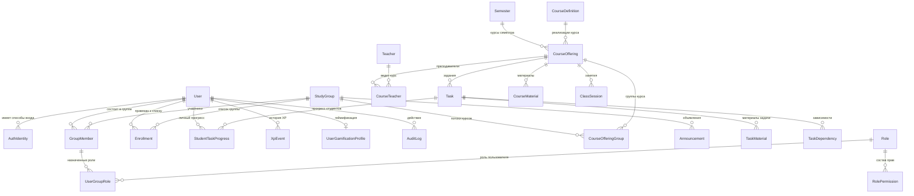

# Модель данных и схема БД (DATA_MODEL)
# Платформа учебного процесса СПбПУ 5130901/40102

---

## 1. Диаграмма сущностей и связей (ER Diagram)



---

## 2. Перечисления (Enums)

```prisma
enum AuthProvider {
  GOOGLE
  TELEGRAM
  LOCAL_DEV
}

enum EnrollmentStatus {
  PENDING_CLAIM    // В списке группы, но пользователь еще не зарегистрировался
  ACTIVE           // Активный подтвержденный студент группы
  ARCHIVED         // Отчислен / переведен
}

enum ProvenanceSource {
  OFFICIAL           // Официальный университетский документ / методичка
  TEACHER            // Слова или сообщение преподавателя
  HEADMAN_CONFIRMED  // Подтверждено старостой
  INFERRED           // Выведено системой эвристически
  PERSONAL           // Личная заметка студента
}

enum TaskType {
  LABORATORY         // Лабораторная работа
  HOMEWORK           // Домашнее задание
  EXERCISE           // Упражнение на паре
  CALCULATION_WORK   // Расчетная работа (РР / РГР)
  PRACTICAL          // Практическое задание
  COURSEWORK         // Курсовая работа / проект
  TEST               // Контрольная работа / тест
  EXAM_PREPARATION   // Подготовка к зачету/экзамену
  CREATIVE_WORK      // Творческое задание
  OPTIONAL           // Факультативное задание
  OTHER              // Прочее
}

enum TaskStatus {
  DRAFT              // Черновик (виден только администраторам)
  PUBLISHED          // Опубликовано (доступно студентам)
  ARCHIVED           // Архивировано
}

enum ProgressStatus {
  NOT_STARTED        // Не начато
  IN_PROGRESS        // В процессе выполнения
  READY              // Сделано, готово к сдаче/демонстрации
  SUBMITTED          // Сдано / отправлен отчет
  ACCEPTED           // Защищено / принято преподавателем
  NEEDS_FIX          // Требуются правки/доработка
}

enum MaterialType {
  FILE               // Локальный/загруженный файл
  EXTERNAL_LINK      // Внешняя ссылка (Google Drive, сайт)
  METHODOLOGY        // Методические указания
  TEXTBOOK           // Учебник / пособие
  PRESENTATION       // Презентация / слайды
  ASSIGNMENT_SPEC    // Условие задания
  TRANSCRIPT         // Транскрипт аудиозаписи
  RECORDING_LINK     // Ссылка на аудио/видео
  SOURCE_CODE        // Исходный код / репозиторий
  OTHER              // Прочее
}

enum SessionType {
  LECTURE            // Лекция
  PRACTICE           // Практика
  LAB                // Лабораторное занятие
  ORGANIZATIONAL     // Организационное собрание
  OTHER              // Прочее
}

enum CalendarSyncStatus {
  PENDING
  SYNCED
  FAILED
}

enum AiSuggestionStatus {
  PENDING            // Ожидает проверки старостой
  APPROVED           // Одобрено (создано задание/дедлайн)
  EDITED             // Отредактировано и принято
  REJECTED           // Отклонено старостой
}
```

---

## 3. Таблицы аутентификации, пользователей и приватности

### 3.1. `User` (Основной профиль пользователя)
| Поле | Тип | Ограничения | Описание |
|---|---|---|---|
| `id` | UUID | PK, default `gen_random_uuid()` | Уникальный ID пользователя |
| `nickname` | String(50) | Unique, Not Null | Публичный никнейм в системе |
| `avatarUrl` | String | Nullable | URL аватара |
| `bio` | String(255) | Nullable | Краткое описание профиля |
| `isSystemAdmin` | Boolean | Default `false` | Глобальный системный администратор |
| `createdAt` | TimestampTZ | Default `now()` | Дата регистрации |
| `updatedAt` | TimestampTZ | Auto update | Дата обновления профиля |

### 3.2. `AuthIdentity` (Способы входа)
| Поле | Тип | Ограничения | Описание |
|---|---|---|---|
| `id` | UUID | PK | Уникальный ID связи |
| `userId` | UUID | FK $\to$ `User.id`, Cascade | Владелец учетной записи |
| `provider` | `AuthProvider` | Not Null | Провайдер (`GOOGLE`, `TELEGRAM`, `LOCAL_DEV`) |
| `providerUserId` | String | Not Null | ID пользователя во внешней системе |
| `email` | String | Nullable | Приватный email (для Google) |
| `metadata` | JSONB | Default `{}` | Данные токена / хэши / телефон |
| `createdAt` | TimestampTZ | Default `now()` | Дата привязки |
*Индекс:* `UNIQUE(provider, providerUserId)`

### 3.3. `StudyGroup` (Учебная группа)
| Поле | Тип | Ограничения | Описание |
|---|---|---|---|
| `id` | UUID | PK | Уникальный ID группы |
| `code` | String(50) | Unique, Not Null | Номер группы (например, `5130901/40102`) |
| `name` | String(100) | Not Null | Название группы |
| `department` | String(100) | Nullable | Институт/кафедра (ИКНК) |
| `program` | String(100) | Nullable | Направление (09.03.01 ИВТ) |
| `calendarId` | String | Nullable | Google Calendar ID общей группы |
| `createdAt` | TimestampTZ | Default `now()` | Дата создания |

### 3.4. `Enrollment` (Студенческий список группы)
| Поле | Тип | Ограничения | Описание |
|---|---|---|---|
| `id` | UUID | PK | Уникальный ID записи |
| `groupId` | UUID | FK $\to$ `StudyGroup.id`, Cascade | Учебная группа |
| `userId` | UUID | FK $\to$ `User.id`, Nullable | Связанный пользователь после регистрации |
| `fullName` | String(150) | Not Null | Реальное ФИО студента (защищенные ПДн) |
| `subgroup` | Int | Nullable | Номер подгруппы (1 или 2) |
| `studentIdNumber` | String(50) | Nullable | Номер студенческого билета / зачетки |
| `status` | `EnrollmentStatus` | Default `PENDING_CLAIM` | Статус связывания |
| `inviteToken` | String | Unique, Nullable | Токен одноразового безопасного клейма |
*Индекс:* `UNIQUE(groupId, fullName)`

### 3.5. `GroupMember` (Членство в группе)
| Поле | Тип | Ограничения | Описание |
|---|---|---|---|
| `id` | UUID | PK | Уникальный ID членства |
| `groupId` | UUID | FK $\to$ `StudyGroup.id`, Cascade | Группа |
| `userId` | UUID | FK $\to$ `User.id`, Cascade | Пользователь |
| `isOwner` | Boolean | Default `false` | Владелец группы (Расул) |
| `joinedAt` | TimestampTZ | Default `now()` | Дата вступления |
*Индекс:* `UNIQUE(groupId, userId)`

---

## 4. Таблицы RBAC (Роли и динамические полномочия)

### 4.1. `Role`
- `id` (UUID, PK)
- `groupId` (UUID, FK $\to$ `StudyGroup.id`)
- `name` (String, например: `Admin`, `CourseManager`, `Student`)
- `isDefault` (Boolean) — выдается ли автоматически новым студентам

### 4.2. `RolePermission`
- `id` (UUID, PK)
- `roleId` (UUID, FK $\to$ `Role.id`, Cascade)
- `permission` (String, Not Null) — строка права (`manage_tasks`, `manage_deadlines`, `manage_course:<courseOfferingId>`, etc.)
*Индекс:* `UNIQUE(roleId, permission)`

### 4.3. `UserGroupRole`
- `id` (UUID, PK)
- `groupMemberId` (UUID, FK $\to$ `GroupMember.id`, Cascade)
- `roleId` (UUID, FK $\to$ `Role.id`, Cascade)
*Индекс:* `UNIQUE(groupMemberId, roleId)`

---

## 5. Учебный контур: семестры, курсы и преподаватели

### 5.1. `Semester`
- `id` (UUID, PK)
- `name` (String, e.g. `Осенний семестр 2026`)
- `number` (Int, e.g. `5`)
- `startDate` (Date, e.g. `2026-09-01`)
- `endDate` (Date, e.g. `2027-01-31`)
- `isCurrent` (Boolean, default `true`)

### 5.2. `CourseDefinition` (Дисциплина в принципе)
- `id` (UUID, PK)
- `code` (String, e.g. `OTU`, `COMPILERS`, `FPGA`)
- `title` (String, e.g. `Основы теории управления`)
- `shortTitle` (String, e.g. `ОТУ`)
- `description` (Text, Nullable)

### 5.3. `Teacher` (Преподаватель)
- `id` (UUID, PK)
- `fullName` (String, e.g. `Нестеров С.А.`, `Цыган Владимир Николаевич`)
- `email` (String, Nullable)
- `telegram` (String, Nullable)
- `notes` (Text, Nullable)

### 5.4. `CourseOffering` (Проведение курса в семестре)
- `id` (UUID, PK)
- `courseDefinitionId` (UUID, FK $\to$ `CourseDefinition.id`)
- `semesterId` (UUID, FK $\to$ `Semester.id`)
- `format` (String, Nullable: `Очный`, `Дистанционный`, `Смешанный`)
- `creditCondition` (Text, Nullable: условия зачета/экзамена)
- `softwareRequired` (Text, Nullable: например `MATLAB/Simulink`, `Flex/Bison`, `Quartus Prime 18.1`)
- `status` (String, default `ACTIVE`)

### 5.5. `CourseOfferingGroup` (Связь проведения курса с группами)
- `id` (UUID, PK)
- `courseOfferingId` (UUID, FK $\to$ `CourseOffering.id`, Cascade)
- `groupId` (UUID, FK $\to$ `StudyGroup.id`, Cascade)
*Индекс:* `UNIQUE(courseOfferingId, groupId)`

### 5.6. `CourseTeacher` (Связь курса и преподавателей)
- `id` (UUID, PK)
- `courseOfferingId` (UUID, FK $\to$ `CourseOffering.id`, Cascade)
- `teacherId` (UUID, FK $\to$ `Teacher.id`, Cascade)
- `role` (String, Nullable: `Лектор`, `Практик`, `Лабораторные работы`)
- `isConflictCandidate` (Boolean, default `false`) — для ситуаций конфликта данных, например СОВД (Семенов vs Кадргулов)

---

## 6. Задания, персональный прогресс и дедлайны

### 6.1. `Task` (Общее задание)
| Поле | Тип | Ограничения | Описание |
|---|---|---|---|
| `id` | UUID | PK | Уникальный ID задания |
| `courseOfferingId` | UUID | FK $\to$ `CourseOffering.id` | Курс, к которому относится задача |
| `title` | String(200) | Not Null | Название (например, `ЛР1: Ознакомительная работа по Lex`) |
| `description` | Text | Nullable | Подробное описание и требования |
| `type` | `TaskType` | Not Null | Тип задания (`LABORATORY`, `HOMEWORK`, etc.) |
| `number` | Int | Nullable | Порядковый номер работы (1, 2, ...) |
| `publishedAt` | TimestampTZ | Default `now()` | Дата и время публикации |
| `dueAt` | TimestampTZ | Nullable | Дедлайн сдачи (`null` = срок не указан) |
| `isTimeStrict` | Boolean | Default `false` | Учитывать ли точное время (true) или дату целиком (false) |
| `isHardDeadline` | Boolean | Default `false` | Жесткий срок (true) или рекомендуемый (false) |
| `status` | `TaskStatus` | Default `PUBLISHED` | Статус публикации |
| `provenance` | `ProvenanceSource` | Default `HEADMAN_CONFIRMED` | Источник информации |
| `externalCalendarEventId`| String | Nullable | ID события в Google Calendar |
| `gradingMetadata` | JSONB | Default `{}` | Максимальный балл, вес в итоговой оценке |
| `createdById` | UUID | FK $\to$ `User.id` | Кто создал задание в системе |
| `updatedById` | UUID | FK $\to$ `User.id` | Кто внес последние изменения |
| `createdAt` | TimestampTZ | Default `now()` | Дата создания |
| `updatedAt` | TimestampTZ | Auto update | Дата изменения |

### 6.2. `StudentTaskProgress` (Личное состояние выполнения)
| Поле | Тип | Ограничения | Описание |
|---|---|---|---|
| `id` | UUID | PK | Уникальный ID записи прогресса |
| `taskId` | UUID | FK $\to$ `Task.id`, Cascade | Задание |
| `userId` | UUID | FK $\to$ `User.id`, Cascade | Студент |
| `status` | `ProgressStatus` | Default `NOT_STARTED` | Текущий личный статус |
| `isConfirmed` | Boolean | Default `false` | Подтвержден ли преподавателем (`ACCEPTED`) |
| `studentNotes` | Text | Nullable | Личные приватные заметки студента |
| `submittedAt` | TimestampTZ | Nullable | Время сдачи отчета студентом |
| `acceptedAt` | TimestampTZ | Nullable | Время фактического зачета работы преподавателем |
| `updatedAt` | TimestampTZ | Auto update | Время последнего обновления статуса |
*Индекс:* `UNIQUE(taskId, userId)`

### 6.3. `TaskDependency` (Зависимости между заданиями)
- `id` (UUID, PK)
- `taskId` (UUID, FK $\to$ `Task.id`, Cascade) — целевое задание
- `dependsOnTaskId` (UUID, FK $\to$ `Task.id`, Cascade) — задание, которое нужно выполнить сначала

---

## 7. Учебные материалы и занятия

### 7.1. `CourseMaterial`
- `id` (UUID, PK)
- `courseOfferingId` (UUID, FK $\to$ `CourseOffering.id`, Cascade)
- `title` (String, Not Null)
- `type` (`MaterialType`, Not Null)
- `url` (String, Not Null) — ссылка на файл / диск / репозиторий
- `description` (Text, Nullable)
- `fileSize` (BigInt, Nullable)
- `provenance` (`ProvenanceSource`, default `TEACHER`)
- `createdAt` (TimestampTZ, default `now()`)

### 7.2. `TaskMaterial` (Материалы конкретного задания)
- `id` (UUID, PK)
- `taskId` (UUID, FK $\to$ `Task.id`, Cascade)
- `materialId` (UUID, FK $\to$ `CourseMaterial.id`, Cascade)
*Индекс:* `UNIQUE(taskId, materialId)`

### 7.3. `ClassSession` (Учебное занятие)
- `id` (UUID, PK)
- `courseOfferingId` (UUID, FK $\to$ `CourseOffering.id`, Cascade)
- `sessionDate` (Date, Not Null)
- `type` (`SessionType`, Not Null)
- `topic` (String, Nullable)
- `room` (String, Nullable)
- `notes` (Text, Nullable)
- `teacherId` (UUID, FK $\to$ `Teacher.id`, Nullable)

### 7.4. `Transcript` (Транскрипт занятия для будущего AI)
- `id` (UUID, PK)
- `sessionId` (UUID, FK $\to$ `ClassSession.id`, Cascade)
- `rawText` (Text, Not Null)
- `audioSourceUrl` (String, Nullable)
- `recordingPart` (Int, default `1`)
- `confidenceScore` (Float, Nullable)
- `createdAt` (TimestampTZ, default `now()`)

---

## 8. Оперативные объявления (Announcements)

### `Announcement`
- `id` (UUID, PK)
- `groupId` (UUID, FK $\to$ `StudyGroup.id`, Cascade)
- `courseOfferingId` (UUID, FK $\to$ `CourseOffering.id`, Nullable)
- `title` (String(200), Not Null)
- `content` (Text, Not Null)
- `isPinned` (Boolean, default `false`)
- `priority` (String, default `NORMAL`: `LOW`, `NORMAL`, `URGENT`)
- `provenance` (`ProvenanceSource`, default `HEADMAN_CONFIRMED`)
- `authorId` (UUID, FK $\to$ `User.id`)
- `publishedAt` (TimestampTZ, default `now()`)

---

## 9. Геймификация и очки опыта (Idempotent XP)

### 9.1. `XpRule` (Настройки начисления очков)
- `id` (UUID, PK)
- `actionCode` (String, Unique, Not Null) — e.g. `TASK_ACCEPTED_LAB`, `TASK_ACCEPTED_HW`, `SUBMITTED_EARLY`
- `xpAmount` (Int, Not Null) — количество XP
- `description` (String, Not Null)

### 9.2. `XpEvent` (Идемпотентный журнал начисления)
- `id` (UUID, PK)
- `userId` (UUID, FK $\to$ `User.id`, Cascade)
- `taskId` (UUID, FK $\to$ `Task.id`, Nullable)
- `ruleCode` (String, Not Null)
- `xpAwarded` (Int, Not Null)
- `createdAt` (TimestampTZ, default `now()`)
*Индекс уникальности:* `UNIQUE(userId, taskId, ruleCode)` (гарантия защиты от фарминга)

### 9.3. `UserGamificationProfile`
- `userId` (UUID, PK, FK $\to$ `User.id`, Cascade)
- `totalXp` (Int, default `0`)
- `currentLevel` (Int, default `1`)
- `optInLeaderboard` (Boolean, default `false`) — явное согласие на участие в рейтинге
- `updatedAt` (TimestampTZ, auto update)

---

## 10. Очередь интеграций и аудит (Integrations & Audit)

### 10.1. `CalendarSyncQueue` (Outbox паттерн)
- `id` (UUID, PK)
- `taskId` (UUID, FK $\to$ `Task.id`, Cascade)
- `action` (String: `CREATE`, `UPDATE`, `DELETE`)
- `status` (`CalendarSyncStatus`, default `PENDING`)
- `attempts` (Int, default `0`)
- `lastError` (Text, Nullable)
- `scheduledFor` (TimestampTZ, default `now()`)

### 10.2. `AuditLog`
- `id` (UUID, PK)
- `userId` (UUID, FK $\to$ `User.id`, Nullable)
- `action` (String, Not Null) — e.g. `CREATE_TASK`, `UPDATE_DEADLINE`, `GRANT_PERMISSION`
- `entityType` (String, Not Null)
- `entityId` (String, Not Null)
- `details` (JSONB, Default `{}`)
- `ipAddress` (String, Nullable)
- `createdAt` (TimestampTZ, default `now()`)
