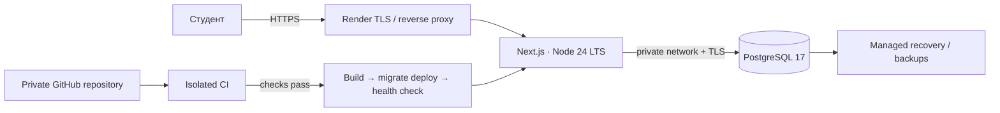

# Production deployment: studentvalue1984.eu.cc

Подготовлено 16 октября 2026. Фактический облачный deployment пока НЕ выполнен: аккаунт/платный тариф, Git remote и DNS требуют действий владельца. Локальный preview не является размещённым сайтом.

## Выбранная архитектура

Render: один постоянно работающий Node Web Service + отдельный managed PostgreSQL 17, регион Frankfurt для обоих. Настройки описаны в корневом `render.yaml`, исходный код находится в приватном GitHub-репозитории. Никаких туннелей на ноутбук и зависимости от локального PostgreSQL.

Почему этот вариант: в проекте уже есть полноценный Next.js server runtime, Prisma и PostgreSQL. Один managed-провайдер убирает отдельное обслуживание VPS, reverse proxy, сертификатов и сервера БД. Статический хостинг этому приложению не подходит. Контейнеры/Kubernetes сейчас не добавляют полезного результата; обычный Node deployment остаётся переносимым на другой хостинг.

Базовые compute-планы в Blueprint: Web `0.5c-512mb`, PostgreSQL `0.1c-256mb`, диск БД явно 1 GB. Ориентир — $7 + $6 = **около $13/месяц за compute**, дополнительно оплачиваются storage, возможные превышения квот, налоги и выбранный workspace plan. Итоговую сумму необходимо проверить на экране Render до создания ресурсов. Это минимальный постоянно работающий пилот, без HA/SLA и без проведённого production load test; при росте памяти/нагрузки планы повышаются. Free compute не выбран из-за требования постоянной доступности.

Источники: [Node web service](https://render.com/docs/deploy-nextjs-app), [планы и идентификаторы](https://render.com/docs/compute-plans), [официальный пример цен сентября 2026](https://render.com/articles/production-rails-hosting-guide), [pricing](https://render.com/pricing), [TLS](https://render.com/docs/tls), [Blueprint](https://render.com/docs/blueprint-spec).

## Что уже реализовано

- `.node-version`: Node **24.22.0 LTS**, проверенный через официальный список релизов Node. `npm ci` воспроизводит lockfile.
- `scripts/render-build.sh`: установка зависимостей → генерация Prisma Client → production build → удаление dev dependencies. TypeScript нужен для `next.config.ts`, Prisma CLI — для pre-deploy migrations; оба явно являются production dependencies. Puppeteer, ESLint и тестовые инструменты в runtime отсутствуют.
- `build:production` не запускает миграции, seed или тесты и проверен с недоступной БД. Не требуется доступ к локальной машине или production-данным при компиляции.
- `db:migrate:production`: только `prisma migrate deploy` отдельным pre-deploy шагом. Нет reset, db push, bootstrap или выдачи владельца.
- `start:production`: строгая проверка конфигурации, bind `0.0.0.0:$PORT`, обработка SIGTERM/SIGINT. Отклоняются dev opt-in, test overrides, локальная/тестовая БД, HTTP origin и отсутствующий постоянный ключ Server Actions. Ошибки конфигурации не печатают значения secrets.
- PostgreSQL URL автоматически получает `sslmode=require`, максимум 5 соединений, connect/pool timeout 3 s. База недоступна из интернета (`ipAllowList: []`); приложение использует private connectionString от Render.
- `/api/health/live` — liveness, `/api/health` — readiness с проверкой PostgreSQL. Readiness возвращает 503 при недоступной БД, без текста исключения и данных пользователя. Ответы не кэшируются. Render переключает трафик на готовую новую версию после health check.
- Заголовки: nosniff, запрет framing/object/base injection, Referrer Policy, Permissions Policy; HSTS в production. Это ограниченная CSP, без заявления о полном nonce-based CSP.
- `.github/workflows/verify.yml`: Node закреплён, GitHub Actions закреплены SHA, PostgreSQL 17 находится внутри CI, production secrets в CI не передаются. Проверяются ядро, E2E, миграции, production-auth, readiness, чистый production runtime и runtime dependency audit. Blueprint ждёт `checksPass`; previews отключены, чтобы случайно не разделять production БД с preview.
- Runtime audit после точечных обновлений: **0 vulnerabilities**. PostCSS закреплён на 8.5.30, deepmerge-ts переопределён на 8.0.2 из-за advisories в транзитивных зависимостях Next/Prisma. Next 15.5.28 и Prisma 6.19.3 сохранены; generate, migrations, build и тесты проверяют совместимость. Полный dev dependency audit всё ещё содержит 9 advisories (7 high, 2 moderate) в инструментах разработки; они исключены из runtime, обновление этого toolchain остаётся отдельной задачей.

Про TLS PostgreSQL: внутренний endpoint Render поддерживает self-signed сертификат; `sslmode=require` шифрует соединение, но не проверяет публичную CA/hostname. Изоляция дополнена private network и запретом внешних подключений. [Официальные режимы соединения](https://render.com/docs/postgresql-creating-connecting).

## Secrets

В Git хранятся только имена и примеры. `DATABASE_URL` внедряется Blueprint из managed БД; пароль генерирует провайдер. `NEXT_SERVER_ACTIONS_ENCRYPTION_KEY` создаёт Render (`generateValue`) как постоянный 256-bit base64 secret. Не заменять его случайным значением на каждом build: он должен совпадать при build и runtime. При ротации требуется новая сборка.

`APP_ORIGIN=https://studentvalue1984.eu.cc` не является секретом. `ALLOW_DEV_AUTH=false`. Не переносить `.env`, `TEST_DATABASE_URL`, `SV_TEST_ISOLATED`, `NEXT_DIST_DIR`, дампы или тестовые cookies в сервис. `.gitignore` исключает `.env.*`, dumps, backups и secrets; разрешены только явно названные example-файлы. `.env.production.example` — документация, её не следует использовать с незаменёнными placeholders.

Токены и пароли не отправлять в чат. Внешние credentials вводятся владельцем в secret/environment settings провайдера, когда соответствующая интеграция будет реализована.

## Точка остановки: нужны аккаунт и согласие на оплату

Сейчас у Git-репозитория нет remote. Аккаунт Render, привязка GitHub, услуги и DNS не создавались и не менялись.

Следующие действия владельца:

1. Подтвердить, что подходит платный Render с описанной базовой стоимостью. Если требуется другой бюджет/провайдер, не применять Blueprint: конфигурацию нужно адаптировать до создания ресурсов.
2. Создать **пустой приватный** GitHub-репозиторий `studentvalue1984` без README/license/gitignore. Приватность важна: репозиторий содержит учебные материалы и историю, публикация их в открытый доступ не требуется. Передать URL репозитория; пароль или access token передавать не нужно.
3. Создать аккаунт [Render](https://dashboard.render.com/) и подключить к нему этот приватный репозиторий, выдавая доступ только к нужному репозиторию. Вход, условия сервиса и billing выполняет владелец.
4. После публикации подготовленного commit дождаться зелёного GitHub workflow **Verify**. Для первого создания это проверяется вручную: `checksPass` управляет последующими auto-deploy. Затем открыть **New → Blueprint**, выбрать репозиторий и `render.yaml`. На экране review проверить Frankfurt, два paid compute-плана, диск 1 GB и итоговый bill. Создание paid resources — только после подтверждения владельца.

После этого продолжение можно выполнить через авторизованный браузер или Render API с credential, сохранённым владельцем в защищённом месте. До этой точки никакой облачный ресурс и запись DNS не изменены.

## DNS и HTTPS — после появления фактического Render service

В Settings → Custom Domains должен быть `studentvalue1984.eu.cc`. Render покажет фактический DNS target; **имя сервиса в YAML не гарантирует конкретный `onrender.com` hostname**. Не придумывать target заранее.

Для поддомена инструкция обычно имеет вид:

| Поле DNS | Значение |
|---|---|
| Type | CNAME |
| Name | `studentvalue1984` в зоне `eu.cc`, либо полное `studentvalue1984.eu.cc` — согласно панели |
| Target | Фактический `…onrender.com`, выданный Render, без `https://` и пути |
| TTL | Auto / 300, если поддерживается |

Если GNAME управляет `studentvalue1984.eu.cc` как корнем отдельной зоны и не разрешает CNAME в apex, следует использовать предложенный Render A/ALIAS/ANAME вариант из его инструкции. Нельзя удалять записи чужой/родительской зоны или подставлять случайный IP. Конфликтующие A/AAAA для **этого** имени проверяются перед изменением. При CAA ограничения должны допускать CA Render.

Затем нажать Verify в Render, дождаться DNS verification и выпуска сертификата, проверить HTTP→HTTPS, цепочку сертификата, `/api/health`, `/login` и закрытые маршруты с поддельными dev cookies. Только после реальной проверки считать HTTPS deployment выполненным. [Инструкция Render](https://render.com/docs/custom-domains).

На 16.10.2026 проверенный DNS-over-HTTPS ответ не содержит A/AAAA/CNAME для указанного имени. Это наблюдение, не подтверждение контроля над DNS; настройки панели владельца пока не проверены.

## Данные и настоящий вход — обязательные условия пилота

Production-сессии проверяются по SHA-256 token hash в БД, но **механизма выпуска сессий пока нет**. Без реальной авторизации сайт после deployment покажет закрытую страницу входа. Это безопасно для подготовки инфраструктуры, но не готовый пилот для студентов. Google OAuth ранее был отложен и в этой подготовке не реализован. Не добавлены общий пароль, temporary admin, login-by-user-id или production test-auth bypass.

Новая production БД получает только схему. Не восстанавливать локальный dump целиком и не запускать bootstrap автоматически: в локальной истории есть dev identities, старые сессии, тестовые артефакты и сомнительные/архивные академические записи. Перенос реальных данных требует отдельного проверенного export/import, с сохранением SourceReference, audience, progress trust, deadline history и приватности Enrollment. Перед переносом и перед первым реальным входом нужно согласовать способ авторизации и привязку студентов к существующему составу группы. Test fixtures никогда не загружаются в production.

## Эксплуатация и восстановление

Paid Render PostgreSQL предоставляет PITR: в Hobby workspace окно 3 дня, Pro+ — 7 дней. Logical exports хранятся у провайдера 7 дней. Нужен проверенный export до schema/data migration и периодический защищённый backup вне основного сервиса; место/учётная запись внешнего хранения ещё не выбраны и не оплачены. Не хранить backups в ephemeral web filesystem. [Backup/recovery](https://render.com/docs/postgresql-backups).

После создания БД выполнить recovery drill в **отдельный** новый экземпляр, проверить migrations и ключевые количества/связи, затем только планировать переключение подключения. Не удалять исходную БД и не выполнять restore с `--clean` поверх реальных данных. Rollback приложения через Render безопасен только при совместимой схеме; автоматического down-migration нет. Будущие schema changes должны сохранять совместимость старой/новой версии в ходе rolling deploy.

Проверять logs/metrics, failed deploys, health checks, память процесса, соединения и заполнение БД. Расходы сверх начального плана и включение HA/дополнительных сервисов требуют решения владельца. Сертификат/доступность/CI на реальном Render ещё не проверены, поскольку resources не созданы.

## Проверка подготовленного кода

- TypeScript, ESLint и форматирование.
- 73 unit/integration теста на отдельной БД, включая отказы небезопасной production-конфигурации и отсутствие secret values в ошибках.
- 11 isolated E2E, рабочая БД остаётся неизменной.
- Production build на Node 24.22.0 с заведомо недоступной БД: успешно.
- 56 production-auth запросов: поддельные сессии/dev cookies не дают доступ даже при `ALLOW_DEV_AUTH=true` при прямом запуске Next. Deployment wrapper дополнительно прекращает запуск с таким флагом.
- Readiness 200 с тестовой БД и 503 при её недоступности, liveness остаётся 200; проверены security/cache headers.
- Чистая копия production artifact: `npm ci --omit=dev --ignore-scripts`, Prisma generate, запуск без `.env`, ESLint/Puppeteer и локальных build tools; readiness и закрытый вход работают.
- Миграции воспроизводятся на свежей изолированной БД, catalog и Prisma совпадают.
- `render.yaml` прошёл проверку по JSON Schema, полученной с `https://render.com/schema/render.yaml.json`. Проверка через Render API и запуск GitHub Actions в облаке ещё не выполнялись.

Тестовые серверы используют отдельные порты 3301–3304 и собственные build/artifact directories. Production resources и реальная БД ими не изменяются. Локально не проверялся Linux runtime Render; это следующий обязательный smoke test после создания аккаунта/resources.
