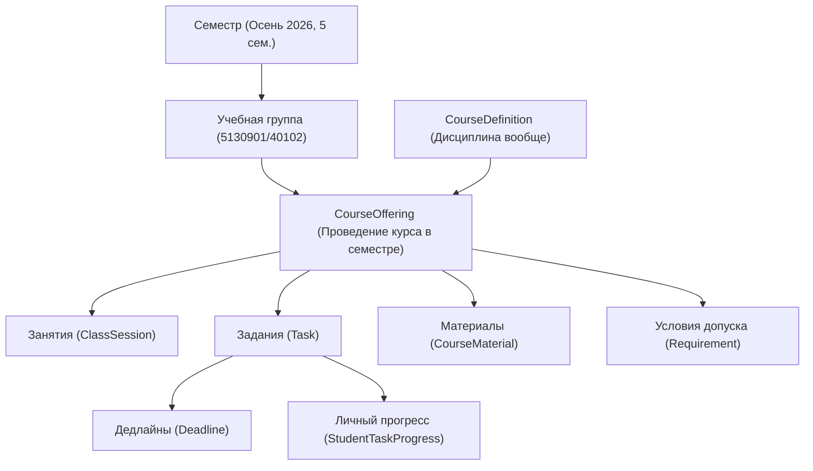
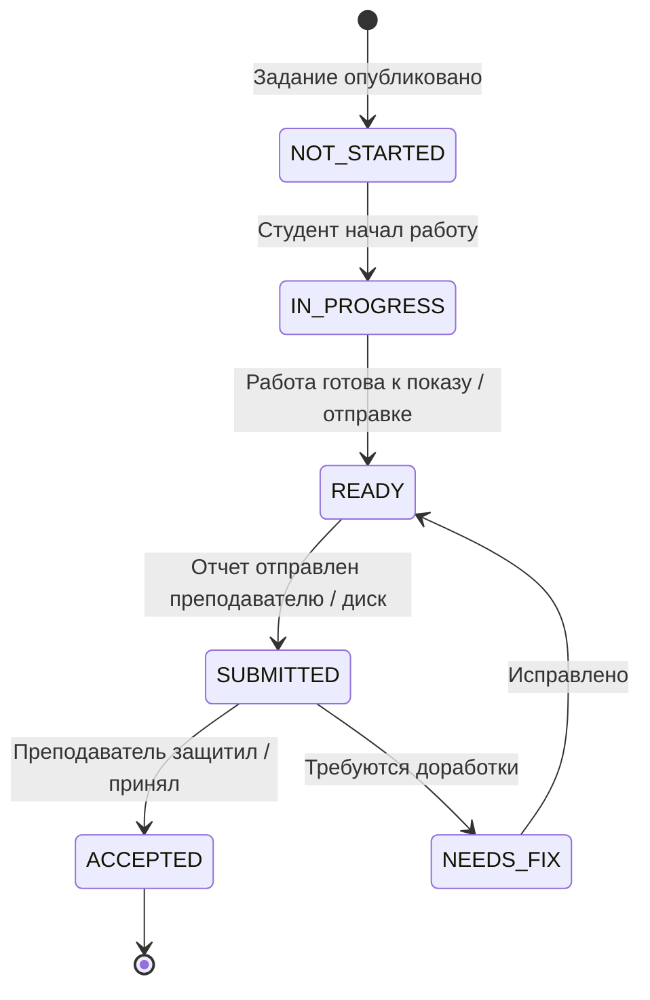

# Продуктовая спецификация (PRODUCT_SPEC)
# Учебная платформа группы СПбПУ 5130901/40102

---

## 1. Продуктовое видение и миссия

### 1.1. Главная проблема
Студенты учебной группы 5130901/40102 (ИКНК СПбПУ) тратят значительное время и когнитивные ресурсы на сбор учебной информации, распыленной между разрозненными каналами:
- Официальная СДО СПбПУ (Moodle/LMS) с фрагментированными курсами;
- Сообщения преподавателей в почте и мессенджерах;
- Чат и канал группы в Telegram;
- Ссылки на папки в Google Drive и Яндекс.Диске;
- Устные указания, озвученные на парах;
- Аудиозаписи лекций и их черновые транскрипты;
- Разрозненные личные заметки старосты и одногруппников.

В результате студент ежедневно задает вопросы:
1. *«Что мне нужно делать прямо сейчас?»*
2. *«Какие задания вообще существуют по предмету, а какие только планируются?»*
3. *«Что я уже сдал, а что преподаватель фактически принял?»*
4. *«Какой дедлайн ближайший, а что уже просрочено?»*
5. *«Где лежит актуальная методичка/шаблон отчета?»*
6. *«Что нужно сдать для допуска к зачету/экзамену?»*

### 1.2. Решение
Веб-платформа, выступающая единым консолидированным интерфейсом над всеми источниками.  
**Платформа НЕ является официальной заменой СДО СПбПУ**, а служит студенческим навигатором и персональным трекером семестра.

### 1.3. Ключевая ценность (North Star UX)
Студент открывает платформу на ноутбуке или смартфоне и за **3–5 секунд** получает исчерпывающий ответ: **«Что мне делать прямо сейчас?»**

---

## 2. Пользовательские сегменты и роли

### 2.1. Студент группы (Member)
- Доступ к обзору семестра, курсам, заданиям, дедлайнам и материалам;
- Управление личным прогрессом по заданиям (`NOT_STARTED` $\to$ `IN_PROGRESS` $\to$ `READY` $\to$ `SUBMITTED` $\to$ `ACCEPTED`);
- Просмотр персональной аналитики прогресса и условий допуска;
- Получение игрового опыта (XP), уровней и достижений за реальные подтвержденные действия;
- Участие в добровольном (opt-in) рейтинге группы без публичного раскрытия долгов или чувствительных оценок.

### 2.2. Староста / Владелец группы (Owner - Расул Батукаев)
- Полный контроль над пространством группы 40102;
- Управление структурой курсов, заданий, дедлайнов, материалов и объявлений;
- Управление участниками группы и сопоставление пользователей с ведомостью (`Enrollment`);
- Гибкое делегирование прав другим студентам (например, назначение ответственного за конкретный предмет).

### 2.3. Доверенный редактор / Модератор курса (Course Manager / Admin)
- Выдача гранулярных прав без наделения полным доступом ко всей группе (аналог прав администраторов в Telegram);
- Редактирование заданий и дедлайнов только по порученной дисциплине или по всем курсам.

---

## 3. Политика приватности и модель идентификации (Privacy by Design)

1. **Единый профиль студента (`User`):**
   - Физический студент имеет строго один профиль в системе.
   - Авторизация через независимые identity providers (`Telegram`, `Google`).
   - Автоматическое связывание аккаунтов по имени **строго запрещено**. Связывание провайдеров происходит только из авторизованного сеанса пользователя.
2. **Публичная vs Реальная идентичность:**
   - Публично одногруппники видят только **Nickname**, **Avatar** и опциональные игровые метрики (XP, уровень, бейджи).
   - Реальные ФИО доступны **исключительно** администраторам с правом `view_private_member_identity`.
3. **Предварительный реестр студентов (`Enrollment`):**
   - Староста может заранее загрузить список группы (ФИО, подгруппа, контакт).
   - При регистрации пользователь связывается со своей записью `Enrollment` через безопасный invite-токен или подтверждение администратором.

---

## 4. Архитектура учебного процесса

### 4.1. Разделение `CourseDefinition` и `CourseOffering`
- `CourseDefinition` — общая дисциплина (например, «Основы теории управления», 09.03.01).
- `CourseOffering` — проведение дисциплины в конкретном семестре для одной или нескольких групп (например, поток 40101 + 40102 или раздельные потоки с индивидуальными дедлайнами).
- Это гарантирует масштабируемость на группу 40101 и последующие семестры без дублирования базовых описаний.

### 4.2. Типология заданий (Расширяемый перечень)
Задания не ограничены только лабораторными работами:
- `laboratory` — лабораторная работа;
- `homework` — домашнее задание;
- `exercise` — аудиторное/семинарское упражнение;
- `calculation_work` — расчетная / расчетно-графическая работа (РР / РГР);
- `practical` — практическое задание;
- `coursework` — курсовая работа / курсовой проект;
- `test` — контрольная работа / тестирование;
- `exam_preparation` — подготовка к зачету/экзамену;
- `creative_work` — творческое/индивидуальное задание;
- `optional` — факультативное задание;
- `other` — прочие учебные активности.

### 4.3. Жизненный цикл задания и личного прогресса
Разделяются сущность задания (`Task`) и персональное состояние студента (`StudentTaskProgress`):

- **Критический принцип:** Событие *«Я закончил / сдал»* (`SUBMITTED`) и событие *«Преподаватель принял / оценил»* (`ACCEPTED`) разделены.
- Пользовательский ввод статуса сохраняется с отметкой времени. Подтвержденные статусы имеют более высокий вес при начислении геймификационных очков.

---

## 5. Дедлайны и управление временем

1. **Типы сроков:**
   - Точная дата и время (`strict_datetime`);
   - Дата без указания времени (`date_only`, интерпретируется как 23:59:59 Europe/Moscow);
   - Рекомендуемый (мягкий) срок (`soft_deadline`);
   - Жесткий срок сдачи (`hard_deadline`);
   - Срок не назначен (`TBD` / `null` — отображается как «Срок не указан», а не фиктивная дата).
2. **Временная зона:**
   - Все расчеты производятся в таймзоне `Europe/Moscow`.
3. **Градация срочности на UI:**
   - 🔴 **Просрочено (Overdue):** Дедлайн прошел, статус не `ACCEPTED`.
   - 🟠 **Сегодня (Today):** Дедлайн истекает в текущие сутки.
   - 🟡 **Завтра (Tomorrow):** Дедлайн истекает завтра.
   - 🔵 **Скоро (Urgent):** Менее 7 дней до срока.
   - ⚪ **Позже / Без срока (Upcoming / No deadline).**

---

## 6. Синхронизация с Google Calendar

1. **Модель интеграции:**  
   События дедлайнов группы $\to$ общий Google Calendar группы 40102.
2. **Надежность и идемпотентность:**
   - Хранение `externalCalendarEventId`.
   - При переносе дедлайна событие в Google Calendar **обновляется**, а не пересоздается.
   - Сбой синхронизации с Google API **никогда не блокирует** транзакцию создания/обновления задания в БД (паттерн Outbox / асинхронный retry worker).
   - Платформа полностью работоспособна без подключенного Google Calendar.

---

## 7. Геймификация и система прогресса

1. **Концепция:**  
   Визуальное представление семестра как RPG-прохождения, мотивирующее закрывать долги заблаговременно.
2. **Анти-фарм и идемпотентность начисления XP:**
   - Начисление очков происходит исключительно по событиям (`XpEvent`).
   - Повторный переход между статусами туда-обратно (`SUBMITTED` $\leftrightarrow$ `IN_PROGRESS`) не дает повторных очков.
   - За подтвержденную сдачу (`ACCEPTED`) начисляется базовый объем XP, за своевременность — бонус.
   - Конфигурация XP хранится в базе данных (`XpRule`), без жесткого хардкода в коде приложения.
3. **Рейтинг (Leaderboard):**
   - Участие исключительно добровольное (`opt-in`).
   - Отображаются только nickname, уровень, бейджи и XP.
   - Никаких публичных списков «двоечников» или раскрытия академических задолженностей без согласия.

---

## 8. Допуски к аттестации (Requirements Engine)

Курс содержит структурированные правила допуска (`CourseRequirement`), например:
- Сдать 100% лабораторных работ (ОТУ / Компиляторы);
- Сдать не менее 2 расчетных работ (СОВД);
- Сдать домашнюю контрольную №1 и очные контрольные (ИКГ/VR).

Интерфейс наглядно отображает: **«Что мне осталось для допуска к зачету/экзамену?»**.

---

## 9. План будущих фаз (Roadmap)

### Фаза 1 (Текущий фокус — MVP):
- Аутентификация, профиль, группы, RBAC/Permissions;
- Курсы, задания, расширяемые типы, дедлайны;
- Личный прогресс студента, персональный дашборд «Что мне делать?»;
- Адаптивные страницы курсов, материалы, объявления;
- Базовая статистика закрытия семестра.

### Фаза 2:
- Синхронизация с Google Calendar;
- In-App уведомления;
- Полноценная геймификация (XP, уровни, достижения, opt-in leaderboard);
- Инструменты быстрого импорта списка группы (CSV).

### Фаза 3:
- Занятия (`ClassSession`) и транскрипты аудиозаписей;
- Глобальный полнотекстовый поиск;
- Telegram-бот для уведомлений;
- AI-инжестия: извлечение фактов из транскриптов с обязательным подтверждением старостой (`Suggestion Review`).
- AI Knowledge Assistant с обязательными ссылками на первоисточник (`Source Citation`).

### Фаза 4:
- Встроенный веб-редактор кода и изолированная среда исполнения (Sandbox Online Judge: C, Python, Verilog/схемы);
- Подключение смежной группы 40101;
- Шаблонизация курсов на будущие семестры.

---

## 10. Ограничения (Чего НЕ делать)

- НЕ делать полноценный клон Moodle;
- НЕ реализовывать видеоконференции или собственный мессенджер;
- НЕ делать публичные профили в открытом интернете;
- НЕ реализовывать сложный движок расписания занятий (для расписания есть готовые сервисы);
- НЕ запускать код пользователя на основном web-сервере без песочницы;
- НЕ принимать AI-решения автоматически без верификации человеком;
- НЕ использовать LLM там, где достаточно детерминированного алгоритма.

---

## 11. Критерии готовности MVP (Definition of Done)

1. **Для старосты (Расул):**
   - Вход в систему $\to$ управление группой 40102;
   - Создание/редактирование курса, добавление задания с типом и дедлайном;
   - Добавление ссылки на материал / методичку;
   - Публикация оперативного объявления;
   - Назначение студенту роли с ограниченным набором прав (например, только редактор одного предмета).
2. **Для студента:**
   - Регистрация и вход в группу 40102;
   - Обзор курсов, активных заданий и дедлайнов;
   - Индивидуальная отметка прогресса с надежным сохранением в БД;
   - Корректный расчет прогресса по предмету и семестру;
   - Полная изоляция от административных действий на стороне сервера.
3. **Надежность и безопасность:**
   - Проверка прав выполняется строго на сервере (Server-side authorization);
   - Данные сохраняются после обновления страницы;
   - Desktop-first адаптивный интерфейс с поддержкой мобильных устройств и Dark/Light режимами.
